# Free React Native animations for Expo

Production-ready animation components for **React Native and Expo**, built with **Reanimated 4**, **Gesture Handler**
and **Skia**. Copy a folder into your project and own the code: no runtime dependency on this repo.

These are the free pieces of [Native Animation](https://nativeanimation.com), a catalog of premium React Native
animations: onboarding screens, carousels, paywalls, loaders, liquid glass tab bars and micro-interactions.

| Animation | Preview | What it is |
|---|---|---|
| [Shimmer Skeleton](animations/shimmer-skeleton) | <a href="https://nativeanimation.com/animations/shimmer-skeleton">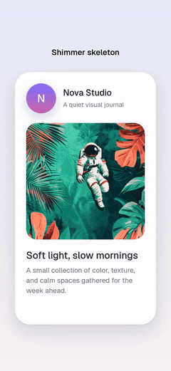</a> | A React Native **skeleton loader** with a synchronized diagonal shimmer for loading placeholders. |
| [Copy Confirm Button](animations/copy-confirm-button) | <a href="https://nativeanimation.com/animations/copy-confirm-button">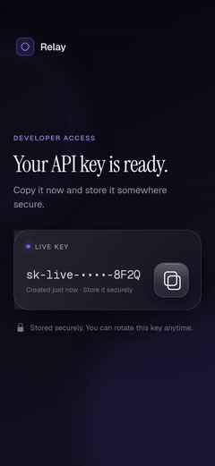</a> | An **animated button** that morphs a copy icon into a check with a success halo and a confirmation bubble. |
| [Drawn Checkbox](animations/drawn-checkbox) | <a href="https://nativeanimation.com/animations/drawn-checkbox">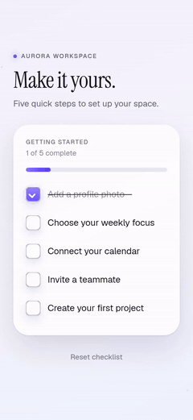</a> | An **animated checkbox** with a spring fill, a hand-drawn check mark and a label strike-through, built with Skia. |
| [Spring Toggle](animations/spring-toggle) | <a href="https://nativeanimation.com/animations/spring-toggle">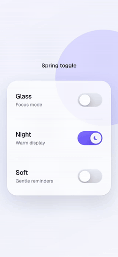</a> | An **animated toggle switch** you can drag: the thumb stretches, glows and settles with a spring. |
| [Burst Like Button](animations/burst-like-button) | <a href="https://nativeanimation.com/animations/burst-like-button">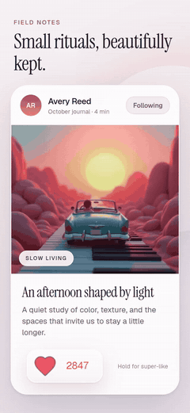</a> | An **animated like button** in Skia: a spring burst, physical particles, a rolling count and a hold-to-charge super-like. |
| [Toast Stack](animations/toast-stack) | <a href="https://nativeanimation.com/animations/toast-stack">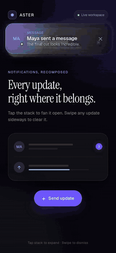</a> | A React Native **toast notification** stack that fans open with depth and dismisses with physical swipes. |
| [Hold to Confirm Button](animations/hold-to-confirm-button) | <a href="https://nativeanimation.com/animations/hold-to-confirm-button">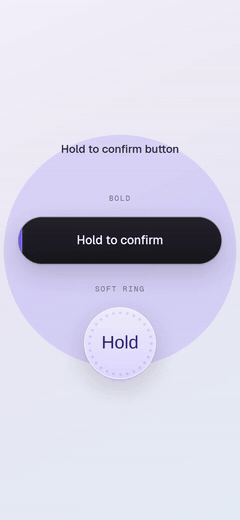</a> | A **hold to confirm button** for destructive or payment actions: a dimensional progress fill and a luminous success finish. |
| [Sliding Segmented Control](animations/sliding-segmented-control) | <a href="https://nativeanimation.com/animations/sliding-segmented-control">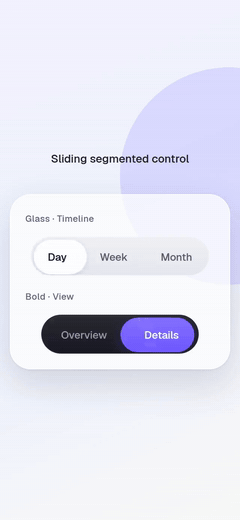</a> | An **animated segmented control** (tabs) with a spring indicator, layered light and a quick selection sweep. |
| [Floating Label Input](animations/floating-label-input) | <a href="https://nativeanimation.com/animations/floating-label-input">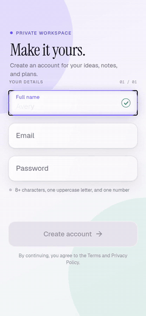</a> | A React Native **floating label text input** with a spring label, focus light, validation feedback and drawn status icons. |
| [Quantity Stepper](animations/quantity-stepper) | <a href="https://nativeanimation.com/animations/quantity-stepper">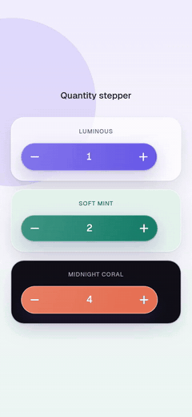</a> | An **Add to cart button** that expands into a rolling **quantity stepper** and collapses again at zero. |
| [Bump Badge](animations/bump-badge) | <a href="https://nativeanimation.com/animations/bump-badge">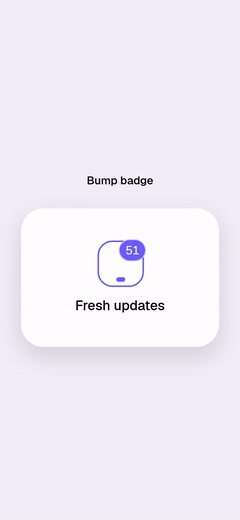</a> | An animated **notification badge** counter that bumps with a spring when the count changes. |
| [Auto Height Accordion](animations/auto-height-accordion) | <a href="https://nativeanimation.com/animations/auto-height-accordion">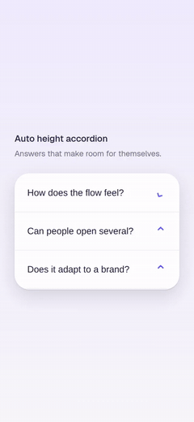</a> | An **animated accordion** (FAQ / collapsible) that measures and animates to any content height. |

## Native Animation Base (MIT, no account)

[Native Animation Base](https://nativeanimation.com/base) is a free family of React Native components that share one theme,
so an agent can compose a complete, coherent app: buttons, inputs, sheets, dialogs, toasts, tabs and full-screen blocks,
with curated spring motion, light and dark modes, and accessible states. **Free forever, MIT licensed** (see the
`LICENSE` in each folder). Every Base piece imports [`base-theme`](animations/base-theme): copy it together with the
pieces you use.

```sh
# No login needed for Base: the CLI copies the piece, its Base dependencies and base-theme
npx nativeanimation add base-sign-in-block
```

With the MCP connected, ask your agent to read the Base design guide and build the screens:
[build with an agent](https://nativeanimation.com/base/docs/build-with-an-agent).

### Blocks

| Block | Preview | What it is |
|---|---|---|
| [Base List Detail Block](animations/base-list-detail-block) | <a href="https://nativeanimation.com/animations/base-list-detail-block">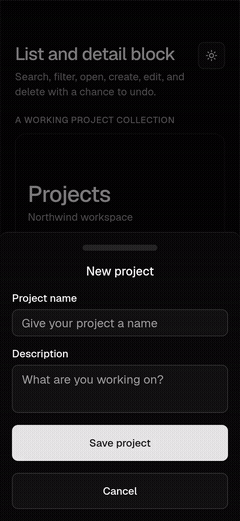</a> | A searchable list and detail screen with configurable records, category filters, avatar and badge data, create/edit forms, delete and undo callbacks, copy… |
| [Base Onboarding Block](animations/base-onboarding-block) | <a href="https://nativeanimation.com/animations/base-onboarding-block">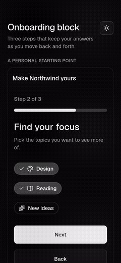</a> | A three-step onboarding screen with configurable goals, interests, daily preferences, copy, answers, step control, callbacks, insets, and theme. |
| [Base Plans Block](animations/base-plans-block) | <a href="https://nativeanimation.com/animations/base-plans-block">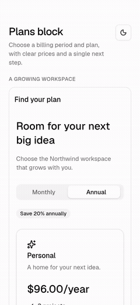</a> | A plan-selection screen with configurable monthly and annual prices, plan content and icons, features, FAQ, selection callbacks, copy, loading, errors… |
| [Base Settings Block](animations/base-settings-block) | <a href="https://nativeanimation.com/animations/base-settings-block">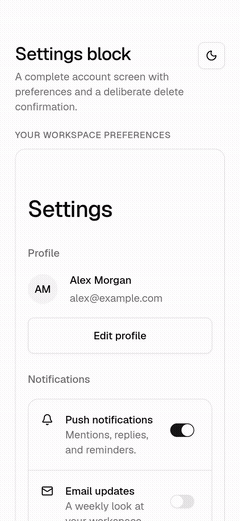</a> | An account settings screen with configurable profile data, notification preferences, language and appearance choices, destructive confirmation, copy… |
| [Base Sign In Block](animations/base-sign-in-block) | <a href="https://nativeanimation.com/animations/base-sign-in-block">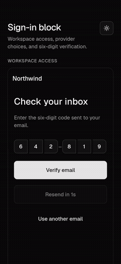</a> | A sign-in screen with a verification step and configurable credential validation, provider buttons, copy, callbacks, loading, errors, insets, and theme. |

### Components

| Component | Preview | What it is |
|---|---|---|
| [Base Accordion](animations/base-accordion) | <a href="https://nativeanimation.com/animations/base-accordion">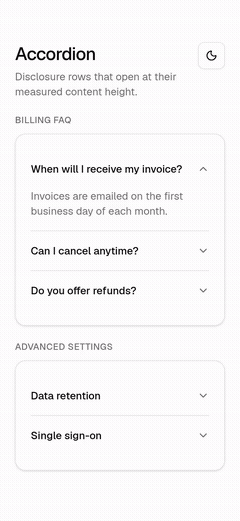</a> | Measured disclosure rows that open smoothly without guessing their content height. |
| [Base Alert](animations/base-alert) | <a href="https://nativeanimation.com/animations/base-alert">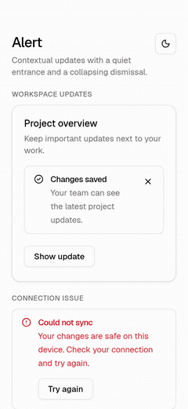</a> | An inline alert with an animated entrance and collapsing dismissal, configurable tone, icon, title, description, action, and theme. |
| [Base Animated Icon](animations/base-animated-icon) | <a href="https://nativeanimation.com/animations/base-animated-icon">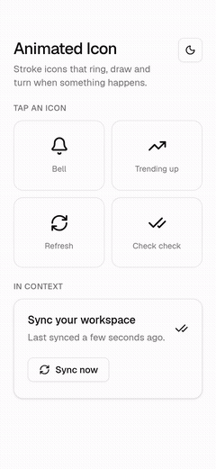</a> | Animated stroke icons that ring, draw, and turn, with configurable icon, size, color, and stroke width. |
| [Base Avatar](animations/base-avatar) | <a href="https://nativeanimation.com/animations/base-avatar">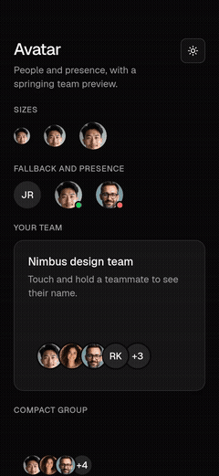</a> | An avatar and overlapping group with press feedback and configurable images, initials, size, and theme. |
| [Base Badge](animations/base-badge) | <a href="https://nativeanimation.com/animations/base-badge">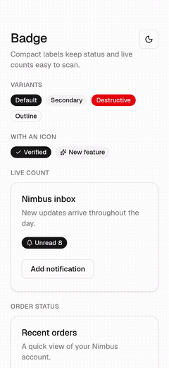</a> | A status badge with a sliding count and configurable content, leading icon, count, and theme. |
| [Base Button](animations/base-button) | <a href="https://nativeanimation.com/animations/base-button">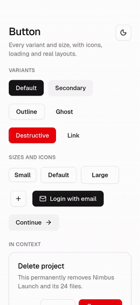</a> | A button with spring-driven press feedback and configurable content, size, variant, and theme. |
| [Base Card](animations/base-card) | <a href="https://nativeanimation.com/animations/base-card">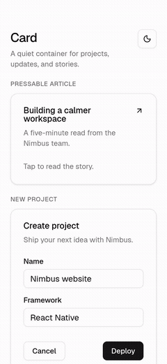</a> | A composable card with optional press feedback and configurable content and theme. |
| [Base Checkbox](animations/base-checkbox) | <a href="https://nativeanimation.com/animations/base-checkbox">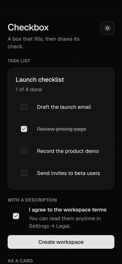</a> | A checkbox with an animated check stroke that takes its colors and radius from a configurable theme. |
| [Base Dialog](animations/base-dialog) | <a href="https://nativeanimation.com/animations/base-dialog">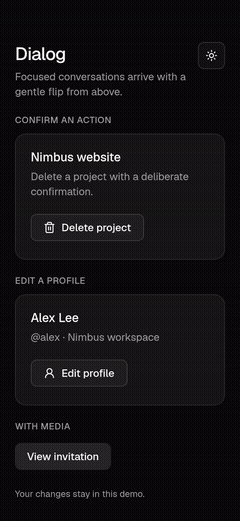</a> | A centered dialog with a spring-driven flip and configurable copy, content, footer, and theme. |
| [Base Empty State](animations/base-empty-state) | <a href="https://nativeanimation.com/animations/base-empty-state">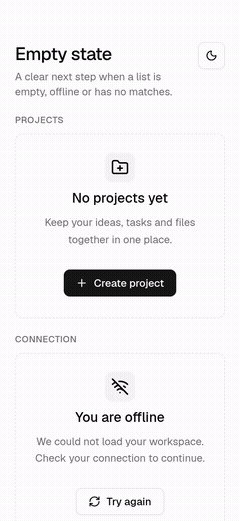</a> | A staggered empty state with configurable icon, title, description, actions, border, and theme. |
| [Base Header](animations/base-header) | <a href="https://nativeanimation.com/animations/base-header">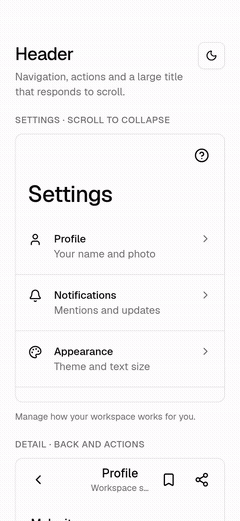</a> | A navigation header with configurable titles, back action, action slots, alignment, safe-area inset, theme, and scroll-driven title handoff. |
| [Base Highlight Text](animations/base-highlight-text) | <a href="https://nativeanimation.com/animations/base-highlight-text">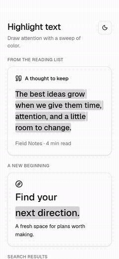</a> | A left-to-right highlight sweep behind each wrapped text line, with configurable text, highlight color, duration, delay, trigger, typography, and theme. |
| [Base Input](animations/base-input) | <a href="https://nativeanimation.com/animations/base-input">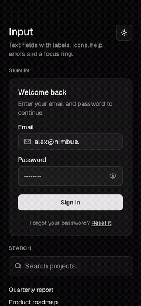</a> | A text field with a fading focus ring, animated password reveal and clear controls, auto-growing multiline text, and configurable labels, icons, validation… |
| [Base Input OTP](animations/base-input-otp) | <a href="https://nativeanimation.com/animations/base-input-otp">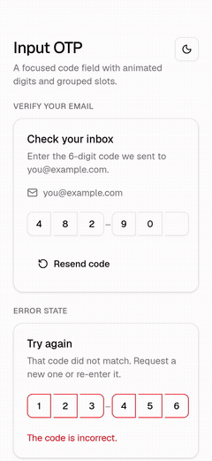</a> | A passcode field with a sliding focus ring and configurable code length, digit groups, and theme. |
| [Base List Row](animations/base-list-row) | <a href="https://nativeanimation.com/animations/base-list-row">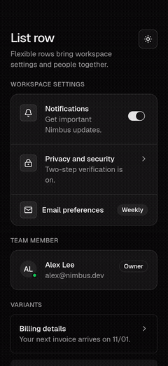</a> | A composable list row with press feedback and configurable copy, leading content, trailing content, and theme. |
| [Base Menu](animations/base-menu) | <a href="https://nativeanimation.com/animations/base-menu">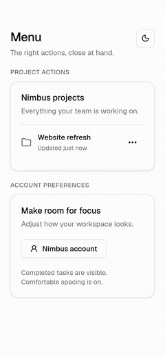</a> | An anchored action menu with configurable items, trigger, alignment, and theme. |
| [Base Popover](animations/base-popover) | <a href="https://nativeanimation.com/animations/base-popover">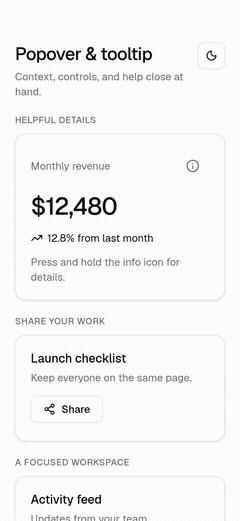</a> | Anchored popovers and long-press tooltips with configurable content, trigger, placement, alignment, width, open state, labels, delay, and theme. |
| [Base Progress](animations/base-progress) | <a href="https://nativeanimation.com/animations/base-progress">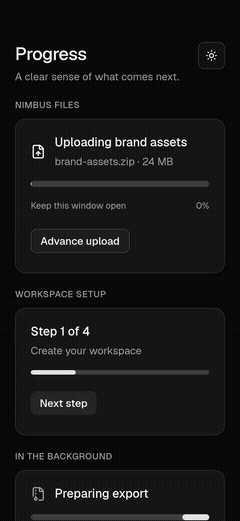</a> | A determinate or indeterminate progress bar with animated updates and configurable value, height, and theme. |
| [Base Radio Group](animations/base-radio-group) | <a href="https://nativeanimation.com/animations/base-radio-group">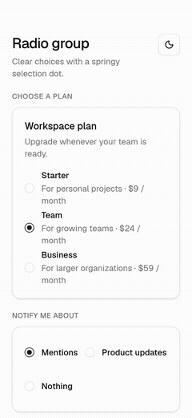</a> | A radio group with spring-driven selection dots and configurable options, orientation, and theme. |
| [Base Select](animations/base-select) | <a href="https://nativeanimation.com/animations/base-select">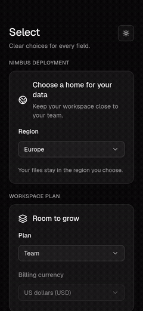</a> | A select field with an anchored option list and configurable options, placeholder, label, and theme. |
| [Base Separator](animations/base-separator) | <a href="https://nativeanimation.com/animations/base-separator">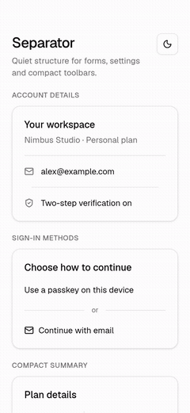</a> | A static horizontal or vertical separator with configurable inset, optional horizontal label, semantics, and theme. |
| [Base Sheet](animations/base-sheet) | <a href="https://nativeanimation.com/animations/base-sheet">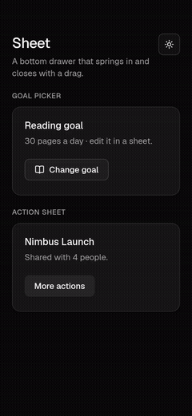</a> | A bottom sheet with a 400 ms timing entry and drag dismissal, with configurable copy, content, footer, and theme. |
| [Base Skeleton](animations/base-skeleton) | <a href="https://nativeanimation.com/animations/base-skeleton">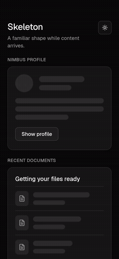</a> | Synchronized loading placeholders with configurable width, height, corner radius, and theme. |
| [Base Slider](animations/base-slider) | <a href="https://nativeanimation.com/animations/base-slider">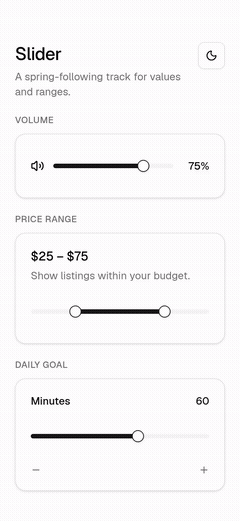</a> | A value or range slider with spring-following thumbs and configurable bounds, step, and theme. |
| [Base Sliding Number](animations/base-sliding-number) | <a href="https://nativeanimation.com/animations/base-sliding-number">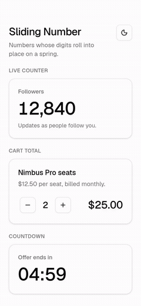</a> | A rolling number display with independent digit springs and configurable value, formatting, font, and color. |
| [Base Switch](animations/base-switch) | <a href="https://nativeanimation.com/animations/base-switch">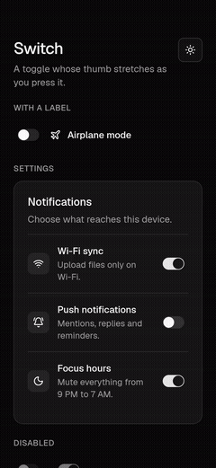</a> | A switch with a stretching, spring-driven thumb that takes its colors and radius from a configurable theme. |
| [Base Tab Bar](animations/base-tab-bar) | <a href="https://nativeanimation.com/animations/base-tab-bar">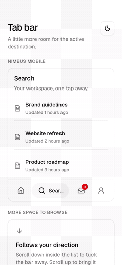</a> | A bottom tab bar that expands the active destination, with configurable items, bottom inset, and theme. |
| [Base Tabs](animations/base-tabs) | <a href="https://nativeanimation.com/animations/base-tabs">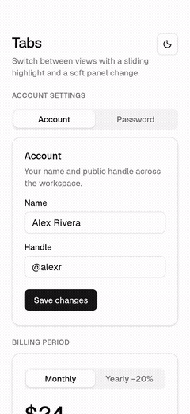</a> | Tabs with a spring-driven highlight and shifting content, with configurable labels, panels, and theme. |
| [Base Toast](animations/base-toast) | <a href="https://nativeanimation.com/animations/base-toast">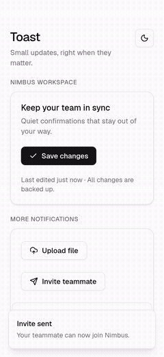</a> | A notification stack with swipe dismissal and configurable position, duration, visible count, and theme. |
| [Base Toggle Group](animations/base-toggle-group) | <a href="https://nativeanimation.com/animations/base-toggle-group">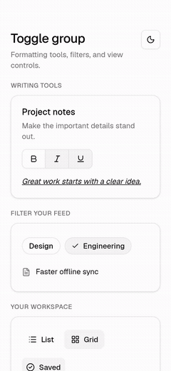</a> | Spring-driven toggles, sliding single selection, and checkmark filter chips with configurable items, selection, sizes, variants, and theme. |
| [Base Typing Text](animations/base-typing-text) | <a href="https://nativeanimation.com/animations/base-typing-text">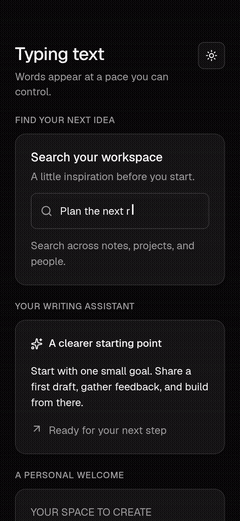</a> | Character-by-character text with configurable phrases, typing speed, delay, looping, cursor, completion callback, typography, and theme. |

## Make it yours

Each preview shows one way to style the component; your app supplies the content and the design. Every piece is
delivered as source in your project: start with its documented props to adapt colors, typography, and copy, and edit
the source when your design needs more than the API exposes. Available controls differ by piece and are listed in each
README.

For example, restyle [Copy Confirm Button](animations/copy-confirm-button) with `backgroundColor`, `iconColor`,
`successColor`, `fontFamily`, and `copiedLabel`. For a premium example with your own artwork, fonts, and a full theme,
see the props of [Meal Scan Nutrition](https://nativeanimation.com/animations/meal-scan-nutrition#props).

## Install

Each folder is self-contained. Two ways to add one:

```sh
# With the CLI (free account; copies the source into src/components/<id>/)
npx nativeanimation login
npx nativeanimation add shimmer-skeleton

# Or by hand: copy animations/<id>/ into your project and install its dependencies
npx expo install react-native-reanimated react-native-worklets expo-linear-gradient
```

Dependencies for each piece are listed in its `piece.json` and README.

## Use with your AI coding agent

The Native Animation plugin bundles one shared skill and the MCP server. Your agent can search, compare dependencies,
read real props, and add an animation to the requested Expo screen.

**Claude Code** (2.1.275 or later), inside a session:

```text
/plugin install nativeanimation --marketplace NativeAnimation/react-native-animations
```

You can also register the repository with `/plugin marketplace add NativeAnimation/react-native-animations`, then
install `nativeanimation@nativeanimation` from the plugin panel.

**Codex**, in your terminal:

```sh
codex plugin marketplace add NativeAnimation/react-native-animations && codex plugin add nativeanimation@nativeanimation
```

**Cursor**, from a checkout of this repository:

```sh
bash agent-kit/install-cursor.sh
```

Reload Cursor and confirm the local plugin in Customize; local plugin imports must be enabled. Directory listings
require review. [Package formats and current limitations](agent-kit/FORMATS.md) include the OpenAI submission draft.
For an MCP-only connection, [Add to Cursor](cursor://anysphere.cursor-deeplink/mcp/install?name=nativeanimation&config=eyJuYXRpdmVhbmltYXRpb24iOnsiY29tbWFuZCI6Im5weCIsImFyZ3MiOlsiLXkiLCJuYXRpdmVhbmltYXRpb25AbGF0ZXN0IiwibWNwIl19fQ%3D%3D);
that link does not install the skill.

Ask: *"Add a skeleton loader to the feed while it loads."* Public discovery needs no account. To add through MCP,
run `npx nativeanimation login` yourself; your agent can also use the free source folders without a session.
Paid pieces cost **$9 each or $299 once for All-access (launch price)**.

## Compatibility

Built for **Expo SDK 58**, React Native 0.88, Reanimated 4.7 and react-native-worklets 0.13. Every animation runs on
the UI thread from a single shared value, so gestures stay interruptible and there is no React state per frame.
For an Expo SDK 57 project, use the [`sdk-57`](https://github.com/NativeAnimation/react-native-animations/tree/sdk-57)
tag, or let `npx nativeanimation add` pick the right version for your project.

## More animations

The full catalog lives at [nativeanimation.com/animations](https://nativeanimation.com/animations): OTP code input,
wheel picker, confetti, swipe to delete, liquid glass tab bar, animated bar chart, loaders, 3D carousels and more.
One piece costs $9, or get [every current and future animation](https://nativeanimation.com/pricing) with a
one-time payment.

## License

Free to use in unlimited personal and commercial apps under the
[Native Animation License](https://nativeanimation.com/license). Please don't republish the source as a library,
template or UI kit.
